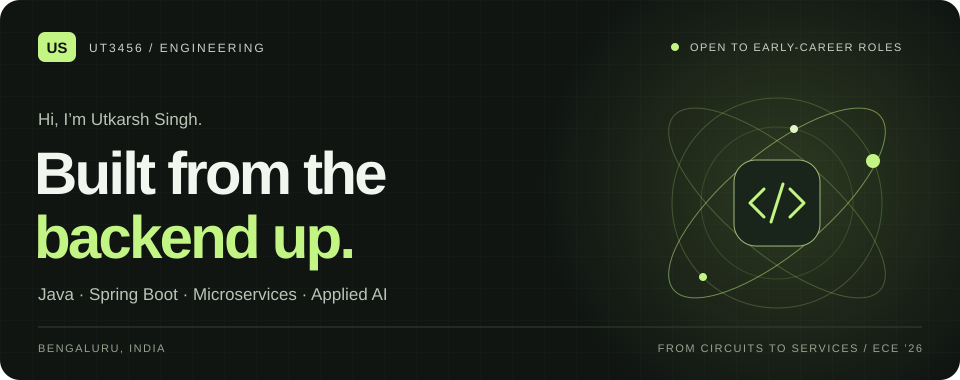
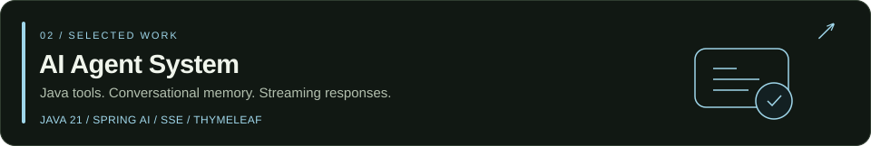
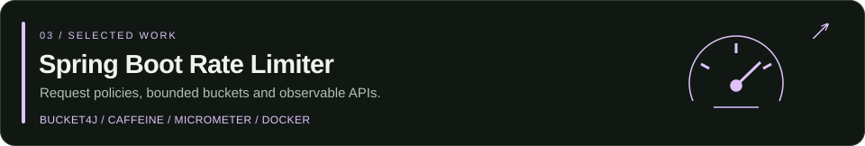

<!-- Custom artwork lives in this repository. No external stats services required. -->

  

  <a href="https://www.linkedin.com/in/utkarsh-singh-ut258"><strong>LinkedIn ↗</strong></a>
  &nbsp;&nbsp; / &nbsp;&nbsp;
  <a href="https://github.com/UT3456/portfolio"><strong>Portfolio source ↗</strong></a>
  &nbsp;&nbsp; / &nbsp;&nbsp;
  <a href="#selected-work"><strong>Selected work ↓</strong></a>

I'm **Utkarsh Singh**, a **Java & Spring Boot developer** building backend services, full-stack applications, and AI assistants.

- **Experience:** hands-on Java full-stack internship work at Cognizant.
- **Background:** Electronics & Communication · Class of 2026 · Bengaluru, India.
- **Interests:** service architecture, API security, observability, and Java tool calling.

**Start with what interests you:**  
[Microservices](https://github.com/UT3456/claimsinsight) · [AI applications](https://github.com/UT3456/AI-agent-System) · [API resilience](https://github.com/UT3456/rate-limiter) · [Spring Security & MongoDB](https://github.com/UT258/journalApp)

## Selected work

**[Explore ClaimInsight360 →](https://github.com/UT3456/claimsinsight)**  
An insurance claims analytics platform with Spring Boot services and a React/TypeScript frontend. My work includes JWT-based authorization, service integration, role-aware interfaces, and distributed tracing.

**[Explore AI Agent System →](https://github.com/UT3456/AI-agent-System)**  
A multi-domain assistant demonstrating travel and customer-support workflows through Java tool calling. Includes local policy retrieval, conversation memory, and token-by-token streaming with Server-Sent Events.

**[Explore Rate Limiter →](https://github.com/UT3456/rate-limiter)**  
A token-bucket implementation with global filters and endpoint-specific `@RateLimit` policies. Uses bounded Caffeine storage, structured HTTP 429 responses, and Micrometer/Prometheus metrics. Buckets are local to each application instance.

**[Explore Journal API →](https://github.com/UT258/journalApp)**  
A private journaling REST API with JWT authentication, per-user entry ownership checks, MongoDB persistence, and tag-based filtering. Includes lightweight, lexicon-based sentiment scoring and trend summaries.

## Beyond the backend

**[Soil Monitoring & Early Alerts →](https://github.com/UT258/soil-moisture-v3)**  
An academic team project connecting my electronics background with full-stack development: a React dashboard and Express/MongoDB backend for sensor readings, maps, and alerts. **In progress:** ML prediction integration.

**[Java problem-solving →](https://github.com/UT258/javaDsa)** · **[LeetCode practice →](https://github.com/UT258/leetcode-Question)**  
The fundamentals behind the projects: practicing Java, data structures, and algorithms.

## The toolkit

| Area | Technologies I work with |
| :--- | :--- |
| **Backend** | Java · Spring Boot · REST APIs · Spring Security · JWT |
| **Data** | MySQL · MongoDB · Spring Data |
| **Services** | Spring Cloud · Eureka · WebFlux · WebClient |
| **Frontend** | React · TypeScript · Redux Toolkit · HTML/CSS |
| **Applied AI** | Spring AI · Tool calling · Conversation memory · SSE |
| **Engineering tools** | Git · Docker · Maven · GitHub Actions |
| **Observability** | Actuator · Zipkin · Micrometer · Prometheus · SonarQube |

---

### Let's build something useful.

I'm interested in **graduate and early-career Java, backend, and full-stack opportunities** where I can contribute, learn through code reviews, and take on harder engineering problems.

**[Connect with me on LinkedIn ↗](https://www.linkedin.com/in/utkarsh-singh-ut258)**

Java at the core. Curiosity in every layer.
